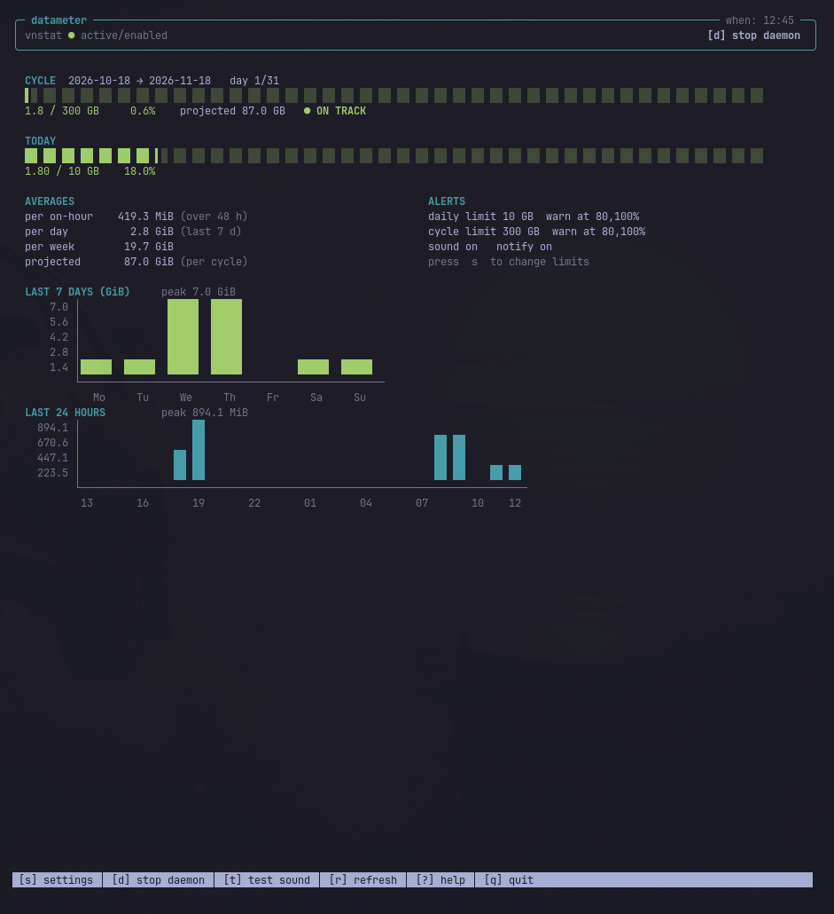

# datameter

Terminal dashboard for [vnstat](https://humdi.net/vnstat/). Python 3 standard
library only; no third-party dependencies.

## AI-generated

This repository was produced **100% by AI**. Every file — code, documentation,
commit messages, and the repository itself — was generated by the
`deepseek-v4.1-flash` model through the `pi` coding agent, on the repository
owner's request. No human wrote or edited the contents.

The code compiles and was exercised against a real vnstat database, but it has
not been reviewed by a human. Read it before relying on it. Provided as is,
without warranty.

## Screenshot



## Features

- Cycle gauge. Shows usage against a configurable cycle allowance, the
  projected total at the current rate, and an on-track / over-budget marker.
  The cycle start day is configurable (for plans that do not reset on the 1st).
- Daily gauge. Shows today's usage against a daily limit.
- Averages. Mean bytes per recorded hour, per day over the last 7 days, per
  week, and the projected cycle total.
- Charts. Vertical bar charts of the last 7 days and the last 24 wall-clock
  hours. Days above the daily limit are drawn red. Hours when the machine was
  off are zero.
- Alerts. Thresholds are percentages of the cycle limit and the daily limit.
  Crossing a threshold plays a generated "tock" sound and sends a desktop
  notification. Each threshold fires once per day and once per cycle.
- Daemon control. Start and stop the vnstat service from the UI.

## Requirements

- Linux
- Python 3.8 or newer
- vnstat 2.x, with the `vnstat` daemon running

Optional, used when present:

- `pw-play`, `paplay`, `ffplay`, or `aplay` for the alert sound
- `notify-send` for desktop notifications
- `systemctl` for the daemon toggle

## Install

```bash
git clone https://github.com/diforenzad-afk/datameter.git
cd datameter
ln -sf "$PWD/datameter" ~/.local/bin/datameter
```

Ensure `~/.local/bin` is in `PATH`.

## Usage

```bash
datameter            # launch the TUI
datameter --once     # print a text summary and exit
datameter --check    # evaluate alert thresholds, notify, exit
datameter --help
```

`--once` is intended for status bars and scripts. `--check` is intended for a
timer and is the only mode that fires alerts without the UI running; see
`examples/`.

## Keys

| Key | Action |
|-----|--------|
| `s` | Open settings. |
| `d` | Start or stop the vnstat daemon. The header and footer show which action applies. |
| `t` | Play the alert sound. |
| `r` | Refresh. |
| `?` | Help. |
| `q` | Quit. |

In settings: `↑`/`↓` (or `k`/`j`) move, `←`/`→` (or `+`/`-`) change a value,
`Enter` edits a text field, `t` tests the sound, `s` saves and returns, `Esc`
returns without saving the current edit.

## Alerts

Open settings with `s`.

1. Under `PLAN`, set `Cycle limit (GB)`, `Daily limit (GB)`, and
   `Cycle start day`.
2. Under `ALERTS`, set `Alert thresholds %` as a comma-separated list, for
   example `80,100`.
3. Under `SOUND & NOTIFICATIONS`, enable or disable the sound and the desktop
   notification, and set the volume.

With a 10 GB daily limit, a 300 GB cycle limit, and thresholds `80,100`, alerts
fire at 8 GB and 10 GB for the day, and at 240 GB and 300 GB for the cycle.
Fired thresholds are recorded in `.alert-state.json` and reset at the start of
each day and cycle, so they do not repeat.

Alerts fire when the UI is running. To fire them while it is closed, run
`datameter --check` from a timer:

```bash
cp examples/datameter-check.service ~/.config/systemd/user/
cp examples/datameter-check.timer   ~/.config/systemd/user/
systemctl --user enable --now datameter-check.timer
```

## Configuration

The configuration file is `config.json`, created next to `datameter.py` on
first run. Every field is editable from the settings screen. The location can
be overridden with the `DATAMETER_CONFIG` environment variable; alert state
uses `DATAMETER_STATE`.

| Key | Meaning |
|-----|---------|
| `interface` | vnstat interface, for example `wlp4s0` |
| `cycle_start_day` | Day of month the plan resets, 1–28 |
| `cycle_limit_gb` | Allowance per cycle |
| `daily_limit_gb` | Daily budget |
| `alert_thresholds_pct` | List of percentages, for example `[80, 100]` |
| `sound_enabled` | Play the alert sound |
| `sound_volume` | Sound volume, 0.0–1.0 |
| `notifications` | Send a desktop notification |
| `refresh_seconds` | Auto-refresh interval |

## Notes and limitations

- The cycle gauge sums only the days present in the vnstat database. vnstat
  retains seven daily entries, so early in a cycle the cycle total and the
  projection are based on a partial window.
- "Per on-hour" is the mean over hours that exist in the database. vnstat
  records an hourly entry only while the daemon is running, so this approximates
  hours the machine was on.
- The daemon toggle runs `systemctl start|stop vnstat`. On systems without an
  active polkit authentication agent, this needs the rule in `contrib/`.
  Install it with `contrib/install-polkit-rule.sh`.
- The alert sound is generated at runtime as `tock.wav` (two damped tones and a
  click, about 55 ms, repeated three times).

## Development

`preview.py` renders a screen to plain text. It runs the UI in a pty and
replays the output with `pyte` when installed, otherwise with a built-in
replay.

```bash
python3 preview.py                 # dashboard
python3 preview.py 's'             # settings
python3 preview.py '?'             # help
python3 preview.py 's down right'  # navigate settings
python3 preview.py '' 90 30        # custom size (columns, rows)
```

## License

MIT. See `LICENSE`.
